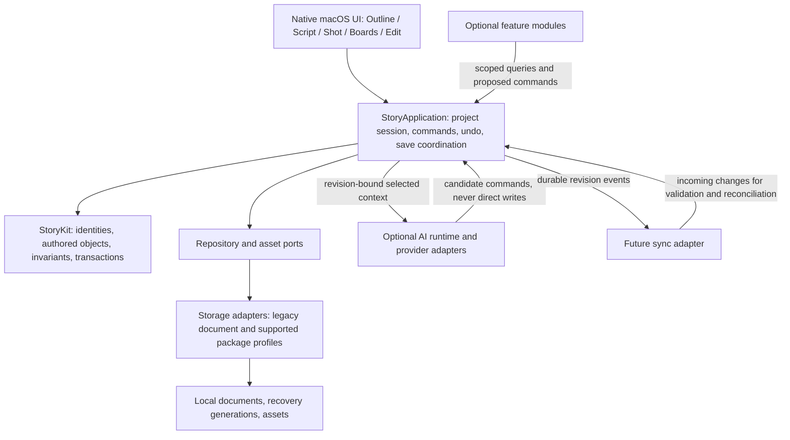

# StoryKit architecture proposal

Date: 2026-10-02. Status: proposal, not implemented architecture or a new file format. Reviewed against checkout `c6ca2dc`.

Build StoryKit by extracting the existing shared model and creative operations incrementally. Preserve Outline, Script, Shot, Boards, and Edit, the native editor, and the current save workflows. StoryKit is the code name; Narrative Engine can be a future product description. No public SDK compatibility promise is needed yet.

## Decisions and corrections

The project is already shared across modes: `OpenScreenplayDocument` contains screenplay, outline, shots, boards, and editorial data. The problem is not five independent documents. It is insufficient separation of domain operations, application orchestration, storage, and presentation—particularly in `ScreenplayViewModel`.

Story is broader than screenplay, but screenplay wording is authored story data. Keep exact text, formatting runs, blank paragraphs, title-page wording, element order, and source identities authoritative. Pages are rendered projections; dialogue is not regenerated from a character graph. A writer can work without filling out character, theme, or location records.

Local authority does not require database authority. For this migration, retain the existing document workflows and portable package direction in `project-format-decision.md`. A future database may provide indexes or a working store; it must not become the only recoverable copy. Making it authoritative requires a separate decision covering transactions, external writers, recovery, and portable snapshots. This proposal deliberately qualifies the supplied database requirement rather than silently overturning the existing portability contract.

Use feature modules before a general plugin runtime. Core editing, saving, reference repair, and undo are not optional plugins. Optional analysis and rendering can use bounded extension interfaces. Do not build dynamic code loading, a marketplace, sync, or provider infrastructure before an actual feature needs it.

## Architecture diagram

Arrows show calls and data flow, not Swift import direction. Storage implements ports declared by the application; StoryKit imports neither storage nor UI.



StoryKit owns creative rules. StoryApplication owns the live session and invokes those rules, registers undo, exposes projections, and requests durable saves. The UI owns focus, caret conversion, IME composition, windows, pickers, zoom, and pane layout. Storage owns bytes and transactions. AI owns neither content nor persistence.

Native input applies a bounded in-memory transaction synchronously on the session's serial executor. Do not await disk, network, media, graph-wide analysis, or provider calls during typing. On macOS, the session can initially remain main-actor isolated behind an adapter while pure command logic is extracted. Background workers consume immutable snapshots; results must check their input revisions before adoption.

## Proposed folder structure

Create targets when code is ready to move, not empty scaffolding for all future services.

```text
Sources/
  StoryKit/                       # Foundation only
    Identity/                     # typed IDs, revisions, source anchors
    Narrative/                    # story, sequences, scenes, beats, entities
    Script/                       # authored blocks, styled text, title page
    Production/                   # shots, boards, media references
    Editorial/                    # independent occurrences, timing, markers
    Relationships/                # typed edges and repair rules
    Commands/                     # validation and atomic in-memory changes
  StoryApplication/
    Sessions/                     # one writable session per opened work
    UseCases/                     # command orchestration, import, adoption
    Projections/                  # lightweight mode-specific read models
    Ports/                        # persistence, assets, optional capabilities
  StoryStorage/
    Legacy/                       # existing document adapter
    Package/                      # preserving supported-package adapter
    Recovery/                     # snapshots, conflicts, durable publication
  ScreenplayDomain/                # temporary compatibility surface
  ScreenplayFDX/                   # retained interchange adapter
  ScreenplayOSApp/                 # existing native editor and presentation
    Adapters/                     # AppKit input, dialogs, undo integration
  StoryFeatures/                  # only as real extracted features warrant
  StoryAIRuntime/                 # later, first provider-backed feature
Tests/
  StoryKitTests/
  StoryApplicationTests/
  StoryStorageTests/
  ScreenplayEditorTests/           # retain native integration coverage
```

Initially StoryApplication can depend on ScreenplayDomain. Move cohesive types into StoryKit later, leaving explicit compatibility aliases where needed. Never introduce a dependency cycle or maintain two writable copies of the same document. Storage codecs adapt the model; model moves must not automatically change encoded keys or schemas.

## Domain model

Use typed IDs backed by existing UUIDs, typed invariants, and composition. An object carries identity, metadata, revision identity where supported, and namespaced extension values. A central revision store retains checkpoints; each object does not embed its complete history. Preserve unknown values through the existing preserving representation rather than a lossy `[String: Any]` conversion.

| Proposed concept | Ownership and existing mapping |
| --- | --- |
| Project | Aggregate identity and catalog; retain existing `Project.id` and screenplay linkage. No accounts or entitlements. |
| Story | Narrative root inside Project. Initially one story; add a persisted StoryID only through an explicit additive schema change. Do not invent historical identity. |
| Sequence | Narrative scene membership/order. Separate type and ID from `EditorialSequence`, which represents an edit. |
| Scene | Stable scene identity, heading-block reference, structure and links. Adapt current scene aliases explicitly; never derive identity from displayed numbers. |
| ScriptContent | Ordered authored block IDs, title page, typography, revision marks and lock references. Necessary in addition to the requested entity list. |
| DialogueBlock / ActionBlock | Typed views of existing `ScreenplayElement` IDs and `StyledText`; retain character cues, parentheticals, transitions, general and unknown types too. No forced paragraph merging. |
| Character / Location | Authored entities adapted from appropriate production records, with aliases. Inferred mentions are derived suggestions until accepted. |
| Beat | Existing `OutlineBeat`, with framework membership and scene links; Save the Cat and Hero's Journey remain optional structural lenses. Distinct from editorial beats. |
| Shot | Existing `Shot`, preserving UUID, order, intent, source anchors and notes. |
| Board | Existing `BoardFrame`, preserving shot links, authored descriptions and timing; no invented image asset for text-only boards. |
| EditSequence / EditInstance | Existing editorial sequence and clip concepts; repeated occurrences have their own IDs, independent of source order. Required beyond the supplied entity list. |
| TimelineMarker | Adapter over current editorial marker semantics after a field inventory; position belongs to a sequence and explicit timebase. Do not rename every editorial beat into a marker. |
| Theme | Optional authored concept and scene/beat links; introduce when a real workflow needs it. |
| Relationship | Typed directed edge with ID, endpoint kinds/IDs, provenance, metadata and optional narrative scope. |
| ReferenceAsset | Creative reference to MediaID and immutable MediaVersionID; bytes and device locations live outside narrative JSON. |
| ResearchItem | Authored notes, citation/source metadata and narrative links. Retrieval chunks and embeddings are disposable derivatives. |
| Version | Project revision/checkpoint metadata, parent revisions, recoverable state and asset pins. Distinct from in-memory undo and screenplay production revision colors. |

Relationships include scene-character, scene-location, scene-beat, scene-shot, shot-board, theme-scene, research-scene and reference-shot. For a strong ownership link, store it once on the owning record; expose it through a relationship query rather than storing a second conflicting edge. Use first-class edge records for authored many-to-many or annotated relationships. Character-to-character edges need a relationship kind and optional story scope.

Order is explicit versioned data. Narrative sequence order, screenplay paragraph order, shot order and edit occurrence order are different lists. Rearranging an edit must not reorder the screenplay. Estimated duration carries method and input revision; measured or user-entered timing remains distinguishable and must not be overwritten by a new estimate.

Deletion preserves historical references as unresolved, never silently retargeted. Split/merge commands repair anchors atomically and report any loss of precision. Undo restores text, order, references and identity together. Never infer an entity rename should rewrite authored dialogue.

## Suggested Swift interfaces

These are interface sketches, not compiled implementation. Supporting value types are intentionally omitted. Keep command variants typed and bounded; do not introduce arbitrary string-keyed mutation dictionaries.

```swift
// StoryKit: no AppKit, SwiftUI, filesystem or provider dependencies.
public protocol StoryCommand {
    associatedtype Output
    func apply(to state: inout StoryState,
               expectedRevision: RevisionID) throws -> ChangeSet<Output>
}

public struct ChangeSet<Output> {
    public let output: Output
    public let changedObjects: Set<ObjectRef>
    public let inverse: StoryMutation
    public let revision: RevisionID
}

// StoryApplication owns this boundary. Implementation serializes writes.
public protocol StorySession: AnyObject {
    var revision: RevisionID { get }
    func perform<C: StoryCommand>(_ command: C,
        expectedRevision: RevisionID) throws -> ChangeSet<C.Output>
    func snapshot(for scope: StoryScope) throws -> StorySnapshot
}

public protocol ProjectRepository {
    func load(_ location: ProjectLocation) async throws -> LoadedProject
    func save(_ snapshot: PersistenceSnapshot,
              to location: ProjectLocation,
              expecting base: StorageGeneration) async throws -> SaveReceipt
}

public protocol AssetStore {
    func resolve(_ version: MediaVersionID) async throws -> AssetHandle
}

// Optional AI runtime. No session, repository or arbitrary write tool supplied.
public protocol StoryAIProvider {
    func generate(_ request: AIRequest) async throws -> CandidateResult
}

public protocol StoryFeature {
    var descriptor: FeatureDescriptor { get }
    func run(_ input: ScopedFeatureInput) async throws -> FeatureResult
}
```

Command contract: failure leaves state unchanged; validate before mutation or use staged touched-record changes. A ChangeSet becomes visible only after all invariants and reference repairs pass. Session history groups native typing appropriately; do not install a second competing Undo stack. Document commands and storage saves use different revision tokens: unsaved changes can advance the session while a background save writes an earlier snapshot. Its receipt only marks that captured generation saved, never newer edits.

StorageGeneration represents the actual opened/saved base, not a timestamp. SaveReceipt is returned only after validated durable publication; conflicts preserve local work separately. PersistenceSnapshot includes preserved unknown content, not just typed projections. Unsupported format capabilities remain read-only.

AIRequest contains explicitly authorized scope, input revisions, purpose and cancellation identity. CandidateResult contains proposed operations and provenance. StoryApplication checks staleness, validates operations and requires explicit undoable adoption. Provider credentials, network policy and billing stay outside StoryKit. FeatureResult follows the same proposed-command boundary. In-process first-party modules are not a security sandbox; untrusted third-party execution would require a separate process and permission design.

## Migration strategy

1. Preserve behavior fixtures before moving a function: exact text/runs, UUIDs, source links, timeline order, undo/redo and saved output. Inventory the actual legacy and supported package paths independently.
2. Extract one bounded creative command behind the existing ViewModel method. Keep UI bindings and the active document unchanged. The ViewModel applies the returned transaction and uses its existing undo/persistence machinery.
3. Move additional related commands only after the first seam proves useful. During transition, each operation has exactly one authoritative implementation; do not dual-write old and new models.
4. Introduce a session owner and narrow read projections. Move history and dirty-state orchestration as one deliberate step, retaining native undo grouping. Keep the recent `ScreenplayChromeState` scoped invalidation behavior.
5. Extract persistence behind repository ports without changing bytes or accepted formats. `PackageTextSession` currently permits a restricted profile; do not interpret its existence as full film-project package editing. Preserve read-only recovery for unsupported companions.
6. Move domain types to StoryKit in cohesive batches. Keep codecs stable. Introduce Story, relationships and additional entities only with documented mappings; conversions remain explicit copies with reports and preserved originals.
7. Add optional AI or plugin interfaces at the first concrete capability. No initial account, network, sync or mobile work.

Rollback is a code-path rollback for each extraction, not a reverse data migration. Since early phases change no format, the prior implementation can still open the same files. Any later format change requires its own compatibility and recovery gate.

## Technical debt priorities

| Address now | Reason |
| --- | --- |
| ViewModel command boundaries | Creative mutations, UI state, dialogs, imports and persistence are mixed; extraction enables isolated correctness checks. |
| Typing and first-edit latency | The latest performance record still misses the under-50ms goal. A new abstraction must not add full-document work per keystroke. |
| Identity and reference contracts | Existing UUIDs, legacy scene aliases and package scene IDs need explicit adapters rather than guessed equivalence. |
| Two persistence paths and unknown-data protection | Legacy Codable models and preserving package sessions have different capabilities; unify interfaces before unifying representations. |
| Revision, history and save semantics | Keep undo, session revisions, durable generations and future shared revisions distinct. |
| Stale architecture statements | Older documents describe Edit as derived-only and package editing as absent. Current code has evolved; update capability statements alongside verified extraction work, not by treating old plans as current evidence. |

Defer a database-authority switch, generic graph database, event sourcing of every keystroke, CRDTs, cloud sync, public SDK stability, executable plugin loading, provider orchestration, mobile clients and a complete Theme/Research system. None is required to establish the command seam. Native layout code stays native unless a measured, tested extraction benefits the editor.

## Phased implementation and acceptance

| Phase | Bounded delivery | Exit evidence |
| --- | --- | --- |
| 0 | Architecture proposal and current behavior inventory | Explicit ownership and no implied format migration; this document is the proposal only. |
| 1 | Extract shot label/notes editing from `updateShot` into a Foundation-only command, using the current domain model | Stable ID/order/source refs; no-op stays clean; one undo restores exact state; save/reopen parity; UI unchanged. |
| 2 | Extract adjacent shot/board operations, then add the application session seam | Both UI entry points use the same command; no duplicate state; selection and undo grouping survive mode changes. |
| 3 | Extract screenplay text/style transactions only after the seam is proven | Native typing, IME, Unicode, split/merge, paste, undo and printed output parity; repeated long-script benchmarks show no regression. Continue responsiveness fixes in parallel. |
| 4 | Extract legacy/package repository adapters and move stable domain groups into StoryKit | Failure injection, external-change conflicts, recovery and unknown-data fixtures pass; existing formats remain unchanged. |
| 5 | Introduce richer story relationships through one actual feature | Explicit migration mapping, recoverable converted copies where needed, identity and reference tests; no forced metadata for writers. |
| 6 | Add first optional runtime capability | Offline core unaffected; scope/revision checks, cancellation and explicit adoption verified. |

Run `Scripts/test.sh` for affected Swift/native coverage and the full suite at an integration boundary. Compare Release benchmarks using the same long-script fixture and panel configurations, with repeated samples; model-only timings do not prove editor responsiveness. Documentation-only changes do not require rebuilding the application.

The next implementation is Phase 1: a small shot-edit command extraction. It proves the boundary without disturbing the latency-sensitive text path. Screenwriting responsiveness remains the product priority; this architecture work must not displace it.

## Repository evidence and governing records

- `Package.swift`: current target boundaries are ScreenplayDomain, ScreenplayFDX and the macOS app, plus command-line tools and tests.
- `Sources/ScreenplayDomain/ScreenplayDocument.swift`: existing shared aggregate and production/editorial models.
- `Sources/ScreenplayDomain/StyledText.swift`, `PackageTextSession.swift`, `PreservedJSON.swift`: authored styles and restricted preserving package operations.
- `Sources/ScreenplayOSApp/ScreenplayViewModel.swift`: current mutation, history and save orchestration.
- `Sources/ScreenplayOSApp/ScreenplayChromeState.swift`: scoped presentation invalidation to retain.
- `Docs/writing-performance.md`: measured editor limitations; no new performance claim in this proposal.
- `Docs/platform-implementation-contract.md`, `free-core-open-projects-amendment.md`, `ui-ux-design-constitution.md`, `product-architecture.md`: unchanged product and free-core boundaries.
- `Docs/open-screenplay-format-1.0-revised-draft.md`, `project-format-decision.md`, `project-format-migration-plan.md`: portability and migration requirements; drafts and dated implementation notes require live-code verification.
